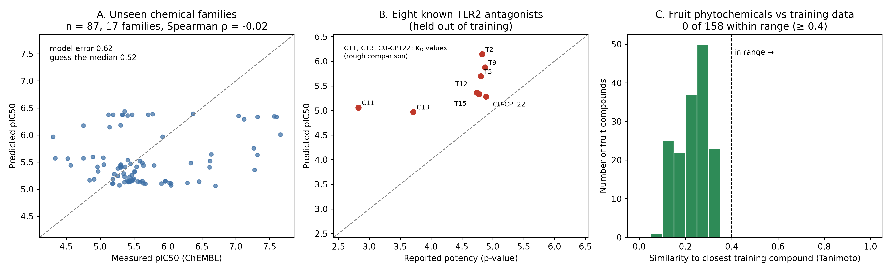

# TLR2 machine learning benchmark (ChEMBL)

A first test of whether public TLR2 antagonist data can predict potency for new chemistry.

## What I did
- Downloaded TLR2 data from ChEMBL (87 compounds with exact potency values, 17 chemical families).
- Trained a random forest model to predict potency (pIC50).
- Tested it on chemical families it had not seen.
- Tested it on 8 published TLR2 antagonists kept out of training.
- Checked how close natural compounds are to the training data.

## Main finding
Public TLR2 data is small and covers few chemical families. The model could not predict
unseen families (Spearman rho = -0.02) and it did not warn when it was wrong. Models for
natural products need an uncertainty score.



## Run it
```
pip install requests rdkit pandas scikit-learn scipy numpy matplotlib openpyxl
python tlr2_ml_step1_data.py --search
python tlr2_ml_step1_data.py --target CHEMBL4163 CHEMBL3885643 CHEMBL3301399
python tlr2_ml_step2_inspect.py --inspect
python tlr2_ml_step3_train.py --train
python tlr2_ml_step4_figure.py
```

## Files
- `tlr2_ml_step1_data.py` - download and clean ChEMBL data
- `tlr2_ml_step2_inspect.py` - check conflicts, chemical families, closeness of test compounds
- `tlr2_ml_step3_train.py` - train and test the model
- `tlr2_ml_step4_figure.py` - make the figure
- `tlr2_chembl_raw.csv`, `tlr2_train_clean.csv` - public ChEMBL data used for training

## Notes
- Potency is pIC50 = 9 - log10(value in nM).
- The 8 held-out antagonists mix IC50 and K_D values, so that comparison is rough.
